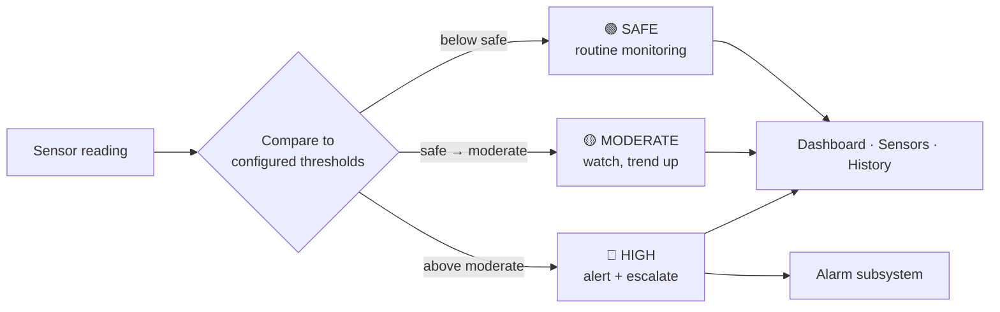
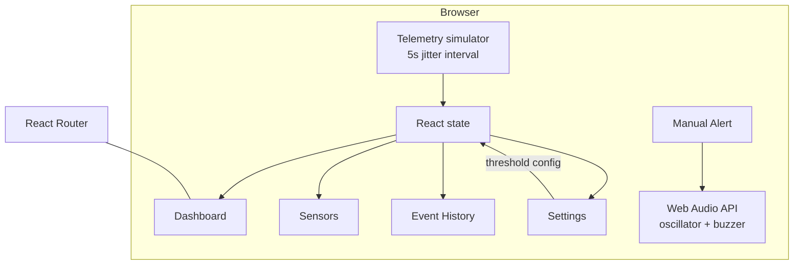
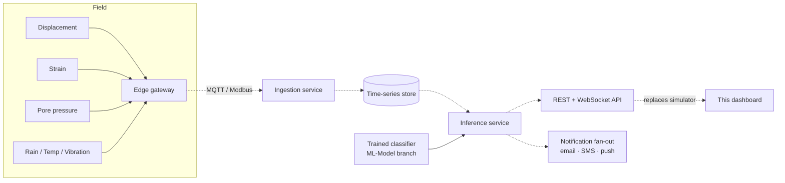
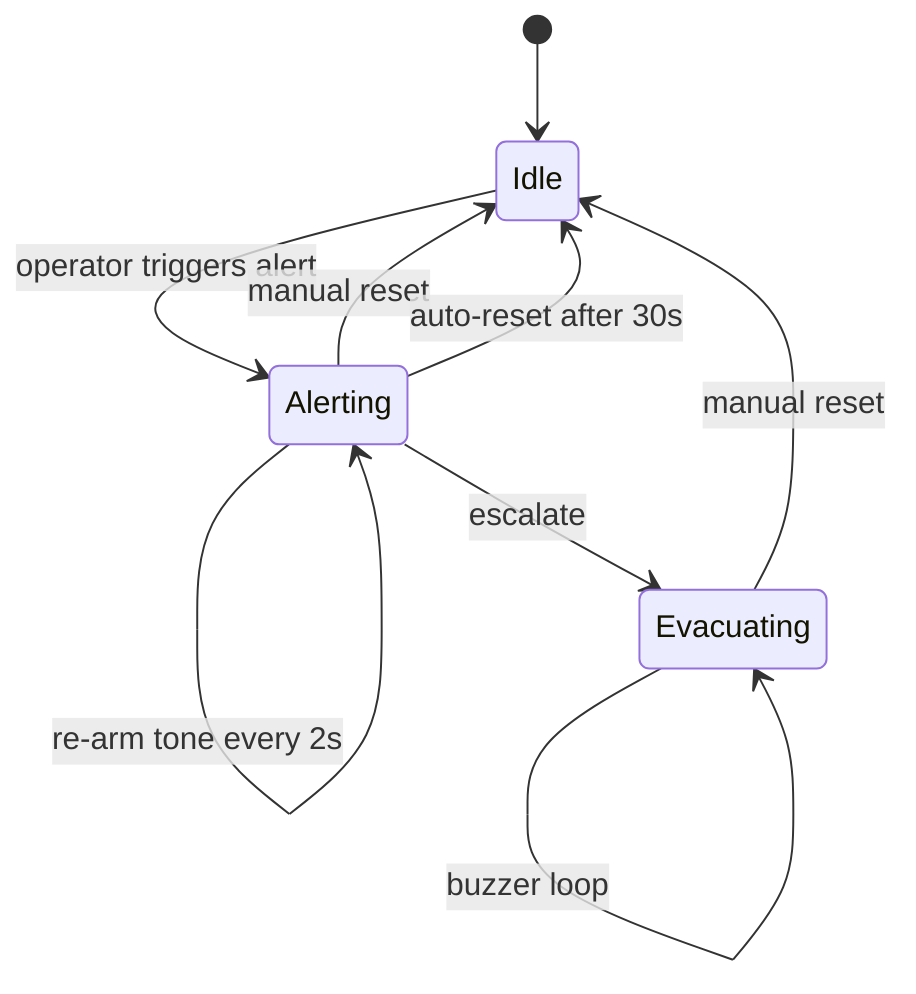

<div align="center">

# AI Rockfall Detection & Prevention

**A control-room dashboard and hazard classifier for slope-stability monitoring in open-pit mines.**

Continuous geotechnical telemetry, threshold-banded risk classification, a trained failure-risk
model, and a one-touch site-wide evacuation alarm.

[](https://react.dev)
[](https://www.typescriptlang.org)
[](https://vitejs.dev)
[](https://tailwindcss.com)
[](https://scikit-learn.org)
[](#hazard-model)
[](https://www.sih.gov.in)
[](LICENSE)

[Project write-up](https://www.divyakush.com/projects/rockfall-prediction) · [Report a bug](https://github.com/Divyakush2006/AI-ROCKFALL-DETECTION-AND-PREVENTION/issues/new/choose) · [Request a feature](https://github.com/Divyakush2006/AI-ROCKFALL-DETECTION-AND-PREVENTION/issues/new/choose)

</div>

---

## Table of Contents

- [Why this exists](#why-this-exists)
- [Project status & scope](#project-status--scope)
- [Features](#features)
- [Monitored parameters](#monitored-parameters)
- [Risk classification](#risk-classification)
- [Hazard model](#hazard-model)
- [Architecture](#architecture)
- [Repository layout](#repository-layout)
- [Alarm subsystem](#alarm-subsystem)
- [Tech stack](#tech-stack)
- [Getting started](#getting-started)
- [Project structure](#project-structure)
- [Design system](#design-system)
- [Roadmap](#roadmap)
- [Contributing](#contributing)
- [Security](#security)
- [License](#license)
- [Team](#team)

---

## Why this exists

Rockfall is one of the deadliest and least predictable hazards in open-pit mining. Slope
failures rarely happen without warning — displacement accelerates, strain accumulates, pore
pressure rises after rainfall — but those signals are spread across instruments that are
typically read in isolation, on different schedules, by different people.

The cost of missing the pattern is measured in lives.

This project attacks the problem from two directions: **a single screen where every geotechnical
signal, its threshold band, and the means to evacuate the site all live together**, and **a
trained classifier that scores failure risk from hydro-geotechnical conditions.** It was built
for **Smart India Hackathon 2025**, where the submission was shortlisted.

---

## Project status & scope

> [!IMPORTANT]
> The project spans **two branches**, and the dashboard and the model are not yet wired
> together. Please read this section before evaluating the code.

| Layer | Status | Location |
|---|---|---|
| Operator dashboard, sensor views, alerting UI, settings | ✅ **Implemented** | `main` |
| Browser-side alarm generation (Web Audio) | ✅ **Implemented** — genuinely functional | `main` |
| Hazard classifier — trained, benchmarked, serialised | ✅ **Implemented** | [`ML-Model`](../../tree/ML-Model) |
| Dashboard telemetry source | ⚠️ **Simulated** — in-memory fixtures on a jitter loop | `main` |
| Inference service joining model to UI | ❌ **Not implemented** | see [Roadmap](#roadmap) |
| Sensor ingestion (MQTT/Modbus), time-series storage | ❌ **Not implemented** | see [Roadmap](#roadmap) |

The dashboard's readings are seeded from realistic fixtures and perturbed on a 5-second
interval to exercise its live-update paths; it makes no network calls. The classifier on the
`ML-Model` branch is real and reproducible, but nothing yet serves its predictions to the UI —
closing that seam is the top roadmap item.

---

## Features

### Operations dashboard
Site-wide posture at a glance: safety score, active sensor count, open alerts, and personnel
on site. A zone risk map plots four monitored zones with severity-coded risk scores, beside a
live alert feed and a chronological event timeline.

### Sensor monitoring
Six instrument classes, each with physical location, purpose, current reading, trend
direction, threshold band, and a per-sensor log of calibration events, warnings, and signal
faults. Readings are paginated four at a time and refresh on a live interval.

### Manual alert & evacuation
A deliberately prominent two-stage control for the case where a human sees what the
instruments do not — covered in [Alarm subsystem](#alarm-subsystem).

### Event history
A searchable, severity-filterable incident timeline with live-counted rollups of critical,
warning, resolved, and active events.

### Data upload
Drag-and-drop ingestion surface for historical sensor exports, with per-file progress and
success/failure states.

### Settings
Operator-configurable **per-parameter thresholds** for all six instrument classes, alert
delivery channels (email / SMS / push), severity subscriptions, refresh rate, data retention,
and alert debounce delay.

---

## Monitored parameters

Six instrument classes, modelled with the units and threshold bands used in slope-stability
practice:

| Sensor | ID | Unit | Safe | Moderate | High | Gauge max | What it tells you |
|---|---|---|---:|---:|---:|---:|---|
| Displacement | `DISP-001` | mm | 0 – 5 | 5 – 8 | > 8 | 12 | Bulk rock movement in the pit wall |
| Strain gauge | `STRN-002` | μɛ | 0 – 100 | 100 – 200 | > 200 | 300 | Material stress and deformation |
| Pore pressure | `PORE-003` | kPa | 0 – 100 | 100 – 150 | > 150 | 200 | Groundwater pressure driving failure |
| Rainfall | `RAIN-004` | mm/h | 0 – 5 | 5 – 15 | > 15 | 25 | Precipitation loading the slope |
| Temperature | `TEMP-005` | °C | 0 – 40 | 40 – 50 | > 50 | 60 | Freeze–thaw and thermal cycling |
| Vibration | `VIB-006` | mm/s | 0 – 5 | 5 – 10 | > 10 | 15 | Blast and seismic ground motion |

Thresholds ship as defaults and are editable per site from **Settings** — pit geometry and rock
mass vary, so hard-coding them would be wrong.

---

## Risk classification

Each reading is banded into one of three states, which drives colour, badge, iconography, and
gauge fill consistently across every view:



Gauge fill is computed as `min(value / gaugeMax, 1)`, normalising six different physical
quantities onto one visual scale — an operator scanning the wall compares saturation, not
numbers in six different units.

---

## Hazard model

Lives on the [`ML-Model`](../../tree/ML-Model) branch: a binary classifier predicting whether
conditions indicate imminent slope failure, trained on 9,864 labelled observations.

**Features** — six hydro-geotechnical measurements:

| Feature | Unit | Range in data |
|---|---|---|
| `Rainfall_mm` | mm | 0 – 300 |
| `Rainfall_3Day` | mm | 0 – 600 |
| `Rainfall_7Day` | mm | 0 – 1000 |
| `Temperature_C` | °C | 5 – 40 |
| `Soil_Strain` | — | 0 – 0.01 |
| `Pore_Water_Pressure_kPa` | kPa | 20 – 200 |

Classes are near-balanced (50.3 % positive), so accuracy is a meaningful headline here rather
than a misleading one.

**Model selection** — six candidates were benchmarked with 5-fold cross-validated F1:
Logistic Regression, Random Forest, Gradient Boosting, XGBoost, LightGBM and an MLP.
**Logistic Regression won** and is the serialised artifact. The package
(`best_rockfall_model_logistic_regression.pkl`) bundles the fitted model, its `StandardScaler`,
the feature names, and the recorded metrics — so inference cannot silently drift from the
preprocessing it was trained with.

**Results** on the held-out test split (n = 1,973), reproduced independently from the
committed artifact rather than quoted from the training run:

| Split | Accuracy | Precision | Recall | F1 | ROC-AUC |
|---|---:|---:|---:|---:|---:|
| Test (held out) | **0.9782** | 0.9817 | 0.9748 | **0.9782** | **0.9758** |
| Validation | 0.9696 | 0.9660 | 0.9738 | 0.9699 | 0.9714 |

Confusion matrix on test: **TN 963 · FP 18 · FN 25 · TP 967**.

In this domain a false negative — a failure the model calls safe — is the expensive error.
25 of 992 positive cases are missed, so recall (0.9748) matters more than accuracy, and the
decision threshold should be tuned toward recall before any field use.

### Honest reading of these numbers

> [!WARNING]
> The headline score is strong, but it is **not** evidence of a hard problem well solved.
> Anyone evaluating this project should know the following.

- **One feature carries the signal.** `Rainfall_mm` correlates with the label at **0.897**;
  every other feature sits below **0.01**. The standardised coefficients say the same —
  Rainfall_mm at **+3.86**, all others under **0.10** in magnitude.
- **A trivial baseline nearly matches the model.** The single rule `Rainfall_mm > 50 mm`
  scores **0.9713 accuracy** on its own, against the model's 0.9782. The classifier buys
  roughly **0.7 points** over one threshold on one sensor.
- **The data appears synthetic**, with labels derived from a rainfall rule. The 3-day and
  7-day accumulations, strain, pore pressure and temperature contribute essentially nothing,
  which is not how real slope failure behaves — antecedent rainfall and pore pressure are
  well-established drivers.
- **`training_dataset.csv` is the full 9,864-row pool**, and the test and validation files are
  exact subsets of it. The published metrics are valid because the model's own split was held
  out — but re-running the notebook with a different seed will leak. Split from the pool
  yourself rather than training on the pool and testing on `test_dataset.csv`.

The correct conclusion is that **the pipeline is sound and the result is honest, but the
dataset is too easy to demonstrate real predictive skill.** Validation against measured
slope-failure telemetry is the work that would make this model meaningful, and it is the
first item on the roadmap.

### Reproducing

```bash
git checkout ML-Model
pip install scikit-learn pandas numpy joblib xgboost lightgbm matplotlib seaborn
python rockfall_ml_model.py
```

Loading the trained artifact directly:

```python
import joblib, pandas as pd

pkg = joblib.load("best_rockfall_model_logistic_regression.pkl")
model, scaler = pkg["model"], pkg["scaler"]

X = pd.read_csv("test_dataset.csv").drop("Label", axis=1)[pkg["feature_names"]]
risk = model.predict_proba(scaler.transform(X))[:, 1]   # P(failure)
```

---

## Architecture

**What runs today** — a self-contained SPA. State lives in React; the telemetry simulator
stands in for the ingestion pipeline:



**Target deployment** — the simulator is replaced at a single seam, leaving every view intact.
Dashed edges are the parts not yet built:



---

## Repository layout

| Branch | Contents |
|---|---|
| [`main`](../../tree/main) | React dashboard — the operator interface documented here |
| [`ML-Model`](../../tree/ML-Model) | Training notebook, three dataset splits, serialised classifier |

The branches are independent: the dashboard does not import the model, and the model has no
knowledge of the dashboard. Unifying them behind an inference service is the top roadmap item.

---

## Alarm subsystem

The one part of the system that must never depend on a network round-trip. It is implemented
directly against the **Web Audio API**, so the browser synthesises the warning tone locally
rather than fetching an asset:



- **Warning tone** — an oscillator sweeping 800 Hz → 600 Hz → 800 Hz over one second, re-armed
  every two seconds so it reads as an alarm rather than a notification.
- **Evacuation buzzer** — a distinct sustained tone from `public/alarm-buzzer.mp3`.
- **Auto-reset** — the buzzer releases after 30 seconds so a triggered alarm cannot be left
  ringing indefinitely.
- **Lifecycle safety** — every timer and `AudioContext` is tracked in refs and torn down on
  reset, so repeated triggering cannot leak audio contexts or stack overlapping loops.

---

## Tech stack

| Concern | Choice |
|---|---|
| Framework | React 18 + TypeScript 5.8 |
| Build | Vite 5 with SWC |
| Styling | Tailwind CSS 3.4, HSL design tokens |
| Components | shadcn/ui on Radix primitives (~40 components) |
| Routing | React Router 6 |
| Charts | Recharts |
| Forms & validation | React Hook Form + Zod |
| Server state | TanStack Query |
| Icons | Lucide |
| Notifications | Sonner |
| Audio | Web Audio API |
| ML (`ML-Model` branch) | scikit-learn, XGBoost, LightGBM, pandas, NumPy, joblib |

---

## Getting started

**Prerequisites:** Node.js 18+ and npm.

```bash
git clone https://github.com/Divyakush2006/AI-ROCKFALL-DETECTION-AND-PREVENTION.git
cd AI-ROCKFALL-DETECTION-AND-PREVENTION
npm install
npm run dev
```

The dev server listens on **http://localhost:8080**.

| Command | Purpose |
|---|---|
| `npm run dev` | Dev server with HMR on port 8080 |
| `npm run build` | Production build to `dist/` |
| `npm run build:dev` | Development-mode build |
| `npm run preview` | Serve the production build locally |
| `npm run lint` | ESLint across the project |

---

## Project structure

```
├── src/
│   ├── pages/
│   │   ├── Dashboard.tsx       # Site posture, zone risk map, alerts, timeline
│   │   ├── Sensors.tsx         # Per-instrument detail, thresholds, logs
│   │   ├── ManualAlert.tsx     # Alert + evacuation control, Web Audio alarms
│   │   ├── EventHistory.tsx    # Searchable, filterable incident timeline
│   │   ├── Upload.tsx          # Drag-and-drop historical data ingestion
│   │   ├── Settings.tsx        # Thresholds, notifications, retention
│   │   └── NotFound.tsx
│   ├── components/
│   │   ├── Layout.tsx          # Shell, responsive navigation
│   │   ├── SensorCard.tsx      # Reading, trend, band gauge, threshold legend
│   │   └── ui/                 # shadcn/ui primitives
│   ├── hooks/                  # use-mobile, use-toast
│   ├── lib/utils.ts            # cn() class merging
│   └── index.css               # Design tokens and component classes
├── public/
│   └── alarm-buzzer.mp3        # Evacuation buzzer
└── vite.config.ts
```

---

## Design system

Built on semantic HSL tokens rather than literal colours, so severity is expressed once and
inherited everywhere — a status change recolours the badge, gauge, border, and glow together.

| Token | Role |
|---|---|
| `--primary` | Interface accent, active navigation, informational state |
| `--success` | Safe band |
| `--warning` | Moderate band |
| `--destructive` | High band, critical alerts |

Gradient and shadow tokens (`--gradient-danger`, `--shadow-glow`) extend the same palette, and
`.sensor-card` centralises panel treatment. The UI is dark-first — control rooms are dim, and
glare costs legibility.

---

## Roadmap

Ordered by what would most increase the system's real-world value:

- [ ] **Validate the model on real telemetry** — the current dataset is too easy to prove predictive skill; measured slope-failure data is what would make the classifier meaningful
- [ ] **Inference service** — serve the `ML-Model` artifact behind an API and replace the dashboard's simulator with its output, joining the two branches
- [ ] **Tune for recall** — a missed failure costs more than a false alarm; pick the operating threshold deliberately rather than defaulting to 0.5
- [ ] **Ingestion service** — MQTT/Modbus gateway writing to a time-series store, behind a typed data client
- [ ] **Live transport** — WebSocket push so readings and alerts stream rather than poll
- [ ] **Persistence** — settings, thresholds, and acknowledged alerts survive reload
- [ ] **Notification fan-out** — wire the configured email/SMS/push channels to a real provider
- [ ] **Geospatial map** — replace the schematic zone layout with surveyed pit coordinates
- [ ] **Auth & audit** — role separation for operators vs. engineers, with an audit trail on threshold edits and alarm triggers
- [ ] **Tests** — threshold banding and alarm lifecycle are the highest-value units to cover

---

## Contributing

Contributions are welcome. Please read the [contributing guide](https://github.com/Divyakush2006/.github/blob/main/CONTRIBUTING.md) before opening a pull request.

## Security

Please report vulnerabilities privately as described in the [security policy](https://github.com/Divyakush2006/.github/blob/main/SECURITY.md). Do not open a public issue.

## License

Released under the [Apache License 2.0](LICENSE).

---

## Team

**Divyakush Punjabi** (lead): dashboard, alarm subsystem, model card and documentation
B.Tech Computer Engineering, VIT Vellore · Major in AI, IIT Ropar
[Portfolio](https://www.divyakush.com) · [GitHub](https://github.com/Divyakush2006) · [LinkedIn](https://linkedin.com/in/divyakush-punjabi)

With [SciAditya03](https://github.com/SciAditya03) (training data and ML pipeline on the `ML-Model` branch) and [abhi-s99](https://github.com/abhi-s99).

Built for **Smart India Hackathon 2025**, where it was shortlisted.

<div align="center">
<sub>If this is useful to you, a ⭐ is appreciated.</sub>
</div>
