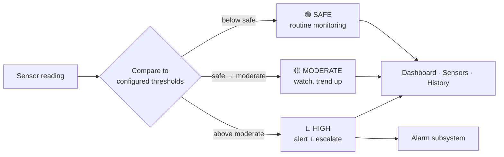
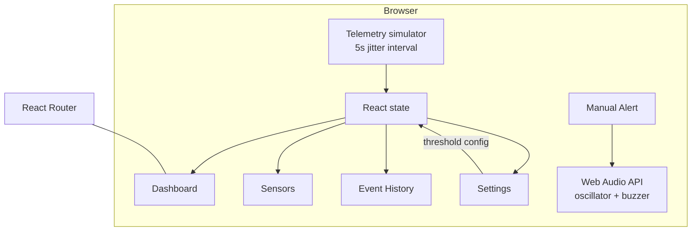
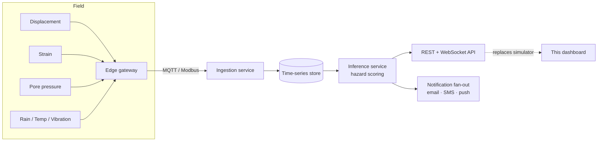
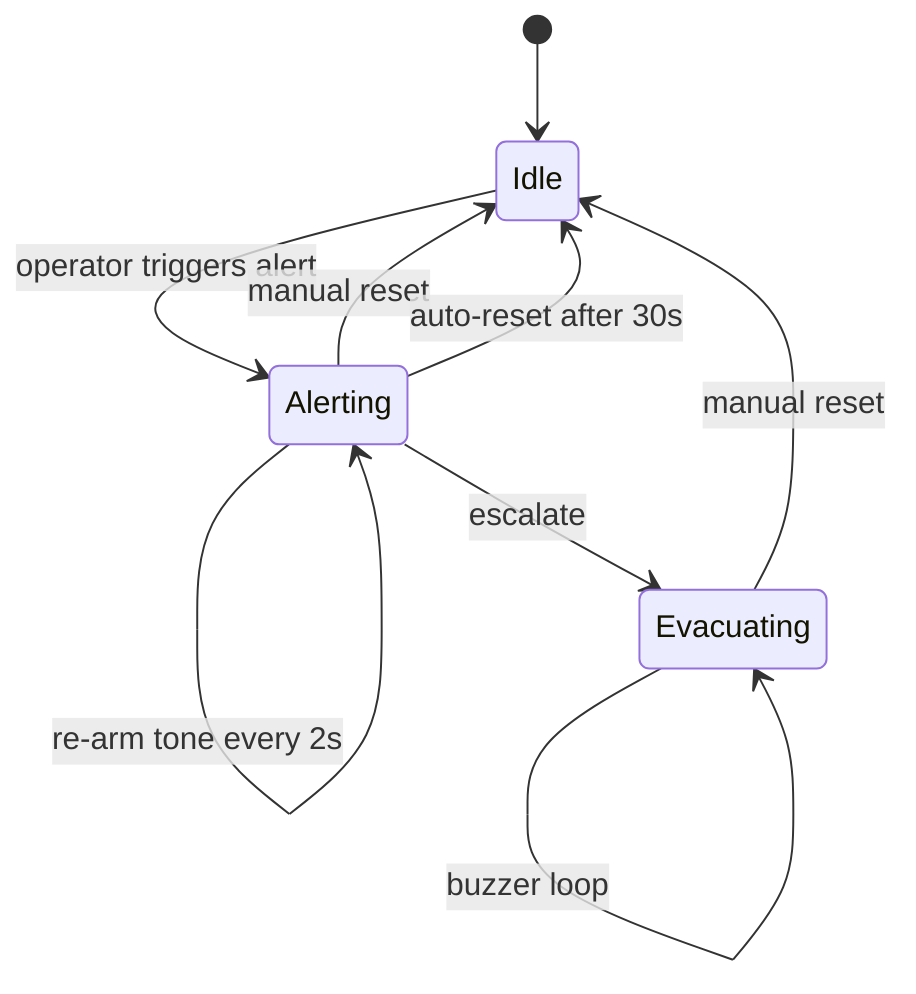

<div align="center">

# AI Rockfall Detection & Prevention

**A control-room dashboard for slope-stability monitoring in open-pit mines.**

Continuous geotechnical telemetry, threshold-banded risk classification, and a one-touch
site-wide evacuation alarm — in a single operator interface.

[](https://react.dev)
[](https://www.typescriptlang.org)
[](https://vitejs.dev)
[](https://tailwindcss.com)
[](https://ui.shadcn.com)
[](https://www.sih.gov.in)

</div>

---

## Table of Contents

- [Why this exists](#why-this-exists)
- [Project status & scope](#project-status--scope)
- [Features](#features)
- [Monitored parameters](#monitored-parameters)
- [Risk classification](#risk-classification)
- [Architecture](#architecture)
- [Alarm subsystem](#alarm-subsystem)
- [Tech stack](#tech-stack)
- [Getting started](#getting-started)
- [Project structure](#project-structure)
- [Design system](#design-system)
- [Roadmap](#roadmap)
- [Author](#author)

---

## Why this exists

Rockfall is one of the deadliest and least predictable hazards in open-pit mining. Slope
failures rarely happen without warning — displacement accelerates, strain accumulates, pore
pressure rises after rainfall — but those signals are spread across instruments that are
typically read in isolation, on different schedules, by different people.

The cost of missing the pattern is measured in lives.

This project addresses the operator-facing half of that problem: **a single screen where every
geotechnical signal, its threshold band, and the means to evacuate the site all live together.**
It was built for **Smart India Hackathon 2025**, where the submission was shortlisted.

---

## Project status & scope

> [!IMPORTANT]
> **This repository contains the frontend application only, and it runs on simulated
> telemetry.** Please read this section before evaluating the code.

| Layer | Status |
|---|---|
| Operator dashboard, sensor views, alerting UI, settings | ✅ **Implemented** — this repository |
| Browser-side alarm generation (Web Audio) | ✅ **Implemented** — genuinely functional |
| Telemetry source | ⚠️ **Simulated** — deterministic in-memory fixtures with a jitter loop |
| Sensor ingestion (MQTT/Modbus), time-series storage, ML inference service | ❌ **Not implemented here** — see [Roadmap](#roadmap) |

Sensor readings are seeded from realistic fixtures and perturbed on a 5-second interval to
exercise the UI's live-update paths. No network calls are made. This is a **high-fidelity
interface prototype**, and it is presented as one — the value on offer is the interaction
design and the domain modelling, not a trained predictor.

---

## Features

### Operations dashboard
Site-wide posture at a glance: safety score, active sensor count, open alerts, and personnel
on site. A zone risk map plots four monitored zones with severity-coded risk scores, beside a
live alert feed and a chronological event timeline.

### Sensor monitoring
Six instrument classes, each with physical location, purpose, current reading, trend
direction, threshold band, and a per-sensor log of calibration events, warnings, and signal
faults. Readings are paginated four at a time and refresh on a live interval.

### Manual alert & evacuation
A deliberately prominent two-stage control for the case where a human sees what the
instruments do not — covered in [Alarm subsystem](#alarm-subsystem).

### Event history
A searchable, severity-filterable incident timeline with live-counted rollups of critical,
warning, resolved, and active events.

### Data upload
Drag-and-drop ingestion surface for historical sensor exports, with per-file progress and
success/failure states.

### Settings
Operator-configurable **per-parameter thresholds** for all six instrument classes, alert
delivery channels (email / SMS / push), severity subscriptions, refresh rate, data retention,
and alert debounce delay.

---

## Monitored parameters

Six instrument classes, modelled with the units and threshold bands used in slope-stability
practice:

| Sensor | ID | Unit | Safe | Moderate | High | Gauge max | What it tells you |
|---|---|---|---:|---:|---:|---:|---|
| Displacement | `DISP-001` | mm | 0 – 5 | 5 – 8 | > 8 | 12 | Bulk rock movement in the pit wall |
| Strain gauge | `STRN-002` | μɛ | 0 – 100 | 100 – 200 | > 200 | 300 | Material stress and deformation |
| Pore pressure | `PORE-003` | kPa | 0 – 100 | 100 – 150 | > 150 | 200 | Groundwater pressure driving failure |
| Rainfall | `RAIN-004` | mm/h | 0 – 5 | 5 – 15 | > 15 | 25 | Precipitation loading the slope |
| Temperature | `TEMP-005` | °C | 0 – 40 | 40 – 50 | > 50 | 60 | Freeze–thaw and thermal cycling |
| Vibration | `VIB-006` | mm/s | 0 – 5 | 5 – 10 | > 10 | 15 | Blast and seismic ground motion |

Thresholds ship as defaults and are editable per site from **Settings** — pit geometry and rock
mass vary, so hard-coding them would be wrong.

---

## Risk classification

Each reading is banded into one of three states, which drives colour, badge, iconography, and
gauge fill consistently across every view:



Gauge fill is computed as `min(value / gaugeMax, 1)`, normalising six different physical
quantities onto one visual scale — an operator scanning the wall compares saturation, not
numbers in six different units.

---

## Architecture

**What runs today** — a self-contained SPA. State lives in React; the telemetry simulator
stands in for the ingestion pipeline:



**Target deployment** — the simulator is replaced at a single seam, leaving every view intact:



---

## Alarm subsystem

The one part of the system that must never depend on a network round-trip. It is implemented
directly against the **Web Audio API**, so the browser synthesises the warning tone locally
rather than fetching an asset:



- **Warning tone** — an oscillator sweeping 800 Hz → 600 Hz → 800 Hz over one second, re-armed
  every two seconds so it reads as an alarm rather than a notification.
- **Evacuation buzzer** — a distinct sustained tone from `public/alarm-buzzer.mp3`.
- **Auto-reset** — the buzzer releases after 30 seconds so a triggered alarm cannot be left
  ringing indefinitely.
- **Lifecycle safety** — every timer and `AudioContext` is tracked in refs and torn down on
  reset, so repeated triggering cannot leak audio contexts or stack overlapping loops.

---

## Tech stack

| Concern | Choice |
|---|---|
| Framework | React 18 + TypeScript 5.8 |
| Build | Vite 5 with SWC |
| Styling | Tailwind CSS 3.4, HSL design tokens |
| Components | shadcn/ui on Radix primitives (~40 components) |
| Routing | React Router 6 |
| Charts | Recharts |
| Forms & validation | React Hook Form + Zod |
| Server state | TanStack Query |
| Icons | Lucide |
| Notifications | Sonner |
| Audio | Web Audio API |

---

## Getting started

**Prerequisites:** Node.js 18+ and npm.

```bash
git clone https://github.com/Divyakush2006/AI-ROCKFALL-DETECTION-AND-PREVENTION.git
cd AI-ROCKFALL-DETECTION-AND-PREVENTION
npm install
npm run dev
```

The dev server listens on **http://localhost:8080**.

| Command | Purpose |
|---|---|
| `npm run dev` | Dev server with HMR on port 8080 |
| `npm run build` | Production build to `dist/` |
| `npm run build:dev` | Development-mode build |
| `npm run preview` | Serve the production build locally |
| `npm run lint` | ESLint across the project |

---

## Project structure

```
├── src/
│   ├── pages/
│   │   ├── Dashboard.tsx       # Site posture, zone risk map, alerts, timeline
│   │   ├── Sensors.tsx         # Per-instrument detail, thresholds, logs
│   │   ├── ManualAlert.tsx     # Alert + evacuation control, Web Audio alarms
│   │   ├── EventHistory.tsx    # Searchable, filterable incident timeline
│   │   ├── Upload.tsx          # Drag-and-drop historical data ingestion
│   │   ├── Settings.tsx        # Thresholds, notifications, retention
│   │   └── NotFound.tsx
│   ├── components/
│   │   ├── Layout.tsx          # Shell, responsive navigation
│   │   ├── SensorCard.tsx      # Reading, trend, band gauge, threshold legend
│   │   └── ui/                 # shadcn/ui primitives
│   ├── hooks/                  # use-mobile, use-toast
│   ├── lib/utils.ts            # cn() class merging
│   └── index.css               # Design tokens and component classes
├── public/
│   └── alarm-buzzer.mp3        # Evacuation buzzer
└── vite.config.ts
```

---

## Design system

Built on semantic HSL tokens rather than literal colours, so severity is expressed once and
inherited everywhere — a status change recolours the badge, gauge, border, and glow together.

| Token | Role |
|---|---|
| `--primary` | Interface accent, active navigation, informational state |
| `--success` | Safe band |
| `--warning` | Moderate band |
| `--destructive` | High band, critical alerts |

Gradient and shadow tokens (`--gradient-danger`, `--shadow-glow`) extend the same palette, and
`.sensor-card` centralises panel treatment. The UI is dark-first — control rooms are dim, and
glare costs legibility.

---

## Roadmap

Ordered by what would most increase the system's real-world value:

- [ ] **Ingestion service** — MQTT/Modbus gateway writing to a time-series store, replacing the simulator behind a typed data client
- [ ] **Hazard inference** — train on historical slope-failure telemetry; publish evaluation metrics honestly alongside the model
- [ ] **Live transport** — WebSocket push so readings and alerts stream rather than poll
- [ ] **Persistence** — settings, thresholds, and acknowledged alerts survive reload
- [ ] **Notification fan-out** — wire the configured email/SMS/push channels to a real provider
- [ ] **Geospatial map** — replace the schematic zone layout with surveyed pit coordinates
- [ ] **Auth & audit** — role separation for operators vs. engineers, with an audit trail on threshold edits and alarm triggers
- [ ] **Tests** — threshold banding and alarm lifecycle are the highest-value units to cover

---

## Author

**Divyakush Punjabi**
B.Tech Computer Engineering, VIT Vellore · Major in AI, IIT Ropar

[Portfolio](https://divyakush.is-a.dev) · [GitHub](https://github.com/Divyakush2006) · [LinkedIn](https://linkedin.com/in/divyakush-punjabi)

Built for **Smart India Hackathon 2025** — shortlisted.

<div align="center">
<sub>If this is useful to you, a ⭐ is appreciated.</sub>
</div>
